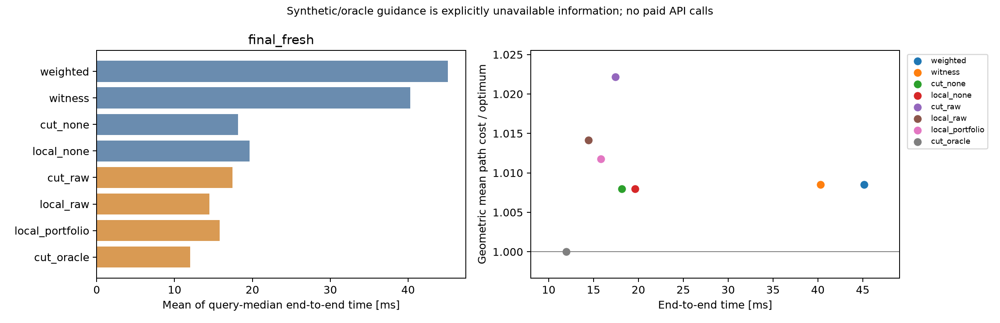
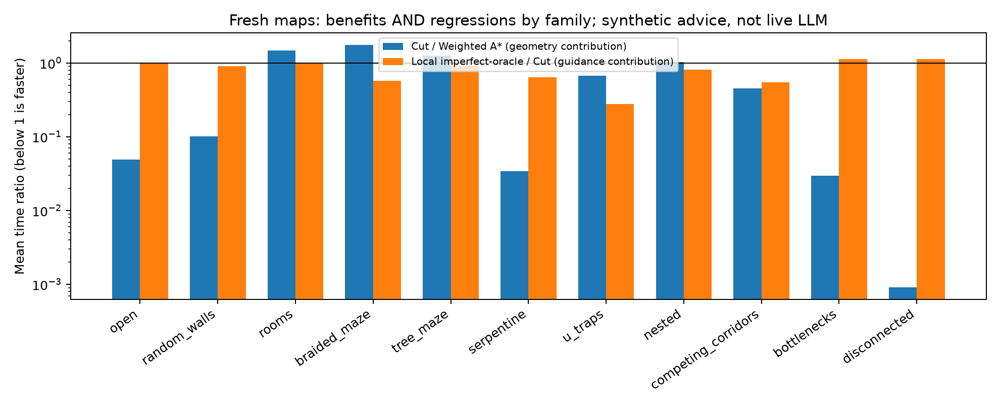

# Session 4 — A verified strategy interface, stronger classical search, and an honest LLM limit

**Conclusion:** Monotone Cut Search is a substantial classical improvement on the
new challenging suite. Verified local refinement can exploit genuinely useful
but imperfect route information. The existing real cached responses still do
not demonstrate a reliable additional LLM-specific advantage. These are three
separate findings, not one claim of LLM acceleration.

Candidate freeze: `0c462d6`, before generating fresh maps. Foundation milestone:
`d65c584`. Work stayed on `research/waypoint-guidance`; main, frozen original and
historical results are preserved. No push, merge, credentials or paid/model API
requests. New inference tokens/cost: zero; historical cache usage/model metadata
cannot be reconstructed reliably. The session started2026-11-17 08:57:26UTC and
continued past the requested three-hour window; wall-clock duration is recorded
in the final checkpoint, not misrepresented as metered active/CPU work.

## 1. What the information audit establishes

The frozen original switches targets when **any generated neighbor equals the
active target**, before checking that neighbor's collision/CLOSED status. It
need not expand or reach that target. Its score is `g + distance(goal) +
distance(target)`; at the final goal that is `g + 2*distance(goal)`. Earlier
adaptive alpha often could not activate: the existing lifetime audit reports
median1 pop,p90=15,93.45% of switched targets active for fewer than30 pops.
These historical measurements were reviewed, not unnecessarily repeated.

A new audit covers all1800 development cache observations:600 distinct queries,
60 maps, standard/CoT/Repe prompting. Witness certifies467/600 queries before
needing guidance. On the remaining133 queries:

|Diagnostic|Standard|CoT|Repe|
|---|---:|---:|---:|
|Nonempty cleaned waypoint chains fully verified|2|4|4|
|Geometric mean cost/optimum of those valid chains|1.1600|1.2063|1.2666|
|Responses with a raw polyline wall crossing|120|127|122|
|Parser abstentions, excluded from crossing count|12|5|8|

A failed straight/lattice link is not proof that every detour between its
endpoints is impossible. It nevertheless explains why blindly treating the
response as an executable short route fails. Across all600 queries, wall-point
rates are11.10%,14.35%,8.73%. Some long outputs end with truncated duplicate
paths: the new parser recovers the last complete marked array or abstains,
without manufacturing the old `(0,0)` fallback. See the authoritative
[version2 audit](development_information_audit_v2/summary.json); the first audit
is retained with its denominator caveats documented in the log.

Coordinate-only representation is **not inherently insufficient**. On120 fixed
development queries, a verified-chain oracle costs0.071ms against Witness0.322ms;
real coordinates0.330ms. Oracle generation is unavailable information and is
excluded explicitly. Both poor advice and integration restrictions matter.
Easy geometric cases also leave little opportunity for advice: most real-cache
queries are solved before consulting it.

## 2. Recommended implementation

The new bounded engine is
[`CutStrategySearch`](../../../llmastar/research/strategic/cut_search.py), with
[`LocalRouteProvider`](../../../llmastar/research/strategic/local_routes.py) as an
optional guidance adapter. [`StrategicLLMAStar`](../../../llmastar/research/strategic/api.py)
retains the assignment result fields for offline structured-query use.

**Monotone Cut Relaxation (MCR).** A real grid path must first visit every integer
wall column/row separating its state from the goal. Retain the crossing
coordinate but ignore obstacles between selected cuts. For cuts c1,...,ck and
free coordinates Fi:

```
Dk(y) = octile((ck,y), goal),                         y in Fk
Di(y) = min[z in F(i+1)] octile((ci,y),(c(i+1),z)) + D(i+1)(z)
Hx(s) = min[y in F1] octile(s,(c1,y)) + D1(y)
H(s)  = max(Hx(s), Hy(s)).
```

First-hit crossings remain ordered even when the real route backtracks. This
relaxation is admissible. Four piecewise-linear minimum transforms compute one
DP step in O(orthogonal map dimension). Lazy column/row transforms, masking and
cache allocation are included in runtime. Independent bounds are maximized,
never unsafely summed.

**Verified strategic refinement.** Guidance may supply coordinate targets,
ordered obstacle IDs/bypass sides, regions or several alternatives. A compiler,
not the model, calculates obstacle endpoint offsets. Actual lattice shortcuts
are checked; failed links may run local A* with32 expansions/link and128 total.
Advice can generate a feasible incumbent U and real-cost prefix seeds. Its
claims, confidence or preferred corridor never become trusted lower bounds.

Return immediately when `U <= w*H(start)`. Otherwise execute complete weighted
search with static priorities `g+wH`, stale-entry checks and reopening on better
g. A verified incumbent may terminate against the live weighted frontier.
Pruning uses admissible `g+H`, not an unverified model estimate. At `w=2` this is
a factor2 guarantee, **not optimality**. At `w=1` the bounded engine is optimal
under numerical tolerances. Unsupported cut geometry retains a complete
weighted fallback. Advice failures do not remove unrestricted search.

The adaptive mechanism is now event-driven proposal use, not a changing alpha:
a provider may intervene when geometric candidates fail or effort exceeds a
budget. Static cached providers cannot pretend to regenerate advice. Scripted
revision experiments use explicitly labelled simulated/oracle responses.
New incumbents/seeds do not change H, so existing heap priorities need no rebuild.
Initial heapify calls are distinct from OPEN rebuilds.

Report-ready pseudocode:

```
STRATEGIC-SEARCH(map, start, goal, provider, w):
    G := fresh exact indexed lattice graph
    if a cheap Witness route is certified optimal: return it
    H := admissible monotone-cut relaxation
    U, route := verify geometric gate-route candidates
    if no bounded certificate exists and provider is available:
        strategies := provider.propose(failure/effort context)
        for strategy within the shared work budget:
            compile obstacle IDs or coordinate targets
            verify shortcuts; repair failed links with bounded local A*
            retain valid route and real-cost prefix seeds
    if U <= w*H(start): return route
    OPEN := start plus improving verified seeds, ordered by g+w*H
    while OPEN has a live entry:
        pop cheapest live snapshot; skip stale/closed duplicates
        if U <= its key: return verified incumbent
        if goal: reconstruct and return the actual lattice path
        expand; prune only with g+H >= U; reopen improved states
        optionally request a scripted revision on an effort event
    return incumbent, or report unreachable
```

[Theory, proofs and primary literature](../../research/session4/THEORY.md).
Hierarchical search, roadmaps and bounded anchors are established ideas; we do
not claim to have invented them. The project contribution is this concrete
relaxation/integration, reproducible controls and measured trust/overhead analysis.

## 3. Frozen fresh-map results

44 queries on22 map-disjoint maps,11 families, sizes96/192.40 reachable and4
unreachable. Independent seeds and sizes; cases generated after candidate freeze.
Seven shuffled timing repeats/query, two predetermined warmup cases excluded.
Times below are **means of per-query medians**, including cold setup, parsing,
all preprocessing/local work, search and internal path checks. Cached input
availability excludes model generation for every method. No real LLM responses
exist on these fresh maps: guidance is labelled oracle-derived synthetic data.

|Method|Time ms|Unique states, local/global union|Heap pops incl. local|Cost/optimum GM|
|---|---:|---:|---:|---:|
|Standard A*|45.781|6098.68|8358.05|1.00000|
|Weighted A*, w2|45.137|4614.93|16029.25|1.00854|
|Witness without hints|40.287|4486.82|15733.75|1.00854|
|Cut search, no hints|18.152|1814.07|5019.02|1.00798|
|Same engine + classical local repair|19.631|1827.55|5063.05|1.00798|
|Raw imperfect synthetic route|17.435|1634.25|4264.45|1.02218|
|**Single imperfect route + bounded local repair**|**14.458**|**1402.36**|**3621.36**|**1.01414**|
|Three imperfect alternatives + repair|15.815|1353.91|3518.00|1.01177|
|Full oracle coordinates|11.981|1033.86|2778.18|1.00000|
|Effort-triggered random→oracle revision|13.659|1189.89|3032.02|1.00049|

Every new/standard method solves40/40 reachable cases, correctly rejects4/4
unreachable cases and has no timeout. The oracle revision is not a deployable
real-model result. Synthetic single/portfolio variants share the exact first
candidate; the portfolio receives more information.

Paired time ratios, exploratory95% map-cluster bootstrap intervals:

- Cut/no-hints ÷ Weighted:0.4022 [0.1396,0.8407].
- Cut/no-hints ÷ Witness:0.4506 [0.1574,0.9333].
- Single repaired synthetic ÷ same cut/no-hints:0.7965 [0.5160,0.9304].
- Single repaired synthetic ÷ classical local repair:0.7365 [0.4256,0.9029].
- Oracle ÷ same cut/no-hints:0.6600 [0.2309,0.8653].
- Portfolio ÷ single repaired:1.0939 [0.9408,1.3367].

Thus good imperfect information has measurable potential beyond geometry in
this suite. The single repaired route saves20.35% mean time over the matched
cut engine, while increasing GM cost ratio by0.00616. It is a quantified
tradeoff, not strict Pareto dominance. The portfolio's development runtime
advantage does not generalize consistently; it remains a quality alternative.
Intervals are unadjusted for multiple comparisons and based on only22 maps.

**Regressions are material.** Cut/no-hints is slower than Weighted in rooms
(3.50 vs2.37ms), braided mazes(18.18 vs10.45), tree mazes(85.81 vs68.38), and
nested structures(54.91 vs53.17). It wins strongly in serpentine maps,
bottlenecks, competing corridors and proving disconnection. Excluding
unreachable cases reduces its aggregate speed advantage. Its maximum observed
cost ratio1.20289 exceeds Weighted/Witness1.10363 despite a slightly better GM.
There is no universal runtime or worst-path-quality dominance.

## 4. Real cached validation: no established LLM-specific win

600 observations =200 distinct queries on20 existing validation maps ×three
styles. This is validation reuse, **not a new unseen real-model test set**.
All600 paths valid; seven timing repeats, same matched controls:

|Method|Time ms|Unique union|Cost/optimum GM|
|---|---:|---:|---:|
|Weighted A*|0.7735|127.70|1.01607|
|Witness without hints|0.3436|59.88|1.00362|
|Cut, no hints|0.3215|19.46|1.00474|
|Cut + actual raw cached hints|0.3185|18.33|1.00466|
|Classical local repair|0.3556|24.79|1.00474|
|Local repair + actual cached hints|0.3398|21.73|1.00507|
|Wrong-query cached hints|0.3191|18.25|1.00469|
|Random free hints|0.3253|18.83|1.00647|
|Oracle route|0.1482|0.00|1.00000|

Raw real ÷ no-hints0.9904 [0.9630,1.0168]; wrong-query0.9924
[0.9601,1.0218]. Real local repair ÷ no-hints1.0568 [1.0249,1.0907].
Cut ÷ Witness0.9358 [0.6647,1.2770] is not a reliable small-map speed win.
Random and incorrect answers are competitive. No causal claim of useful LLM
semantics follows from the small state-count changes.

## 5. Source-quality and mechanism ablations

Separate, post-freeze diagnostic runs reuse the exact fixtures and frozen engine;
there was no tuning based on these fresh results.

On fresh synthetic guidance, local random/wrong/shuffled are respectively
1.2608/1.2527/1.2371 times the useful ordered-source runtime; all three map CIs
exclude1. Disabling local repair costs1.2204 times runtime [1.0422,1.7961].
Removing shortcutting changes time little(0.9887×) but worsens GM cost from
1.01414 to1.03053. These controls support useful **synthetic route information**
and identify local connection repair plus shortcut quality control as contributors.

For actual caches, random/real0.9951 [0.9705,1.0231], wrong/real0.9987
[0.9796,1.0182]; removing local repair is faster0.9634 [0.9397,0.9891].
Therefore the synthetic result cannot be generalized to available real answers.

The no-cut octile control takes44.622ms on fresh maps versus cut18.152ms:
the classical gain is not simply Euclidean→octile replacement. Removing
geometric proposals or prefix seeds changes a few paths/states but does not
explain the main cut-bound gain. All details, CIs and family tables are in
[full tables](final_analysis/TABLES.md) and [statistics](final_analysis/statistics.json).

## 6. Frozen original, runtime components, memory and costs

On predetermined fresh query0/map(22 queries), three repeats and a uniform2s
cap: original native has36 timeout trials; matched original with exact indexed
geometry12. Observed capped means1203.29ms and581.67ms are **censored lower
bounds**, not full completion estimates. New cut10.30ms and guided single7.25ms
have no timeout on that subset. Original scoring/switching/duplicates remain
frozen; geometry is the only matched-original replacement. Original success
varies with the cap, so quality/count means over successful cases are not full-
suite comparisons. Raw rows preserve every failure; missing counters are not
presented as zero savings.

Profiling eight development maze/serpentine oracle queries exposed unnecessary
O(walls×waypoints) interpretation and repeated prefix summation/copying. Archived
before/after diagnostic profiles show legacy inference0.839s before and no calls
after selective skipping; prefix handling0.227s→0.036s, with the same grid
expansion count in that diagnostic. Total instrumented2.934s→1.797s is a profiler
result, not a native speed estimate. Native final tables include all remaining
cut/witness/validation/Python overhead. Lower-bound setup and lazy evaluation
are recorded separately; component medians need not sum exactly to total medians.

Ten predetermined fresh cases have a separate heapq/tracemalloc pass. Mean peak
tracked allocations: Weighted2.403MiB, Witness2.372, cut1.877, guided single1.649.
Maximums: Weighted11.845MiB, cut14.047, guided14.055. Mean memory improves on this
small sample while worst observed allocation increases. This is tracked Python/
exposed-buffer memory, not total native RSS. Exact pushes,pops and heapify sizes
are in the [supplement](final_analysis/SUPPLEMENT.md); timing runs are not
contaminated by instrumentation. Paper-style operation and global g-entry ratios
are also provided, with their proxy limitations stated.

Latency break-even is tiny. With fixed outputs, synthetic local repair saves
about6.25ms per requested response over the matched cut control; oracle about
10.44ms. At100ms or1s model delay, full end-to-end performance loses that gain.
Actual cached real hints have essentially no delay budget; real local repair is
already slower at zero delay. These are **what-if calculations**, not API
measurements. New actual API calls/tokens/billed cost are zero; historic tokens
are unknown. Event-gating can avoid requests on easy maps, but a live model's
quality, latency and costs remain untested. See latency scenarios in
[diagnostics.json](final_analysis/diagnostics.json).

## 7. Rejected approaches and engineering verification

- Coarse component/portal hierarchy: lower-bound ratio0.268 on the pilot, query
  overhead outweighs reduced states; oracle and classical corridors almost equal.
- Singleton portals: bound ratio0.941 but higher setup/Dijkstra overhead; no cold
  runtime win. Retained for correct hierarchical/event-driven comparisons.
- Unbounded ordered waypoint following: valid routes but severe path-quality
  regressions on bad/random targets. Diagnostic only, not the recommended search.
- Pure waypoint filtering/legacy-side inference: does not reliably help actual
  caches; dense all-pair interpretation is expensive. Default off, budgeted opt-in.
- Lazy roadmap: strong small-map classical candidate generator; extra oracle
  vertices can exhaust its finite probe budget. It is not globally complete alone.
- Primal-First: competitive on small caches, weaker than cut-first on large maps.
- Dynamic random→oracle intervention: useful potential but assumes unavailable
  revision quality and additional model delay. Not claimed as a real improvement.
- Three-candidate portfolio: lower state counts/quality gains can cost more time;
  development ranking did not persist on fresh maps.

118 automated tests pass. Separate audit independently rasterizes fresh geometry
with Shapely, checks44 reference shortest distances via Dijkstra,833196 admissible
state bounds,4480 returned valid paths and949396 unit edges. All44 fresh queries
match reachability; all bounded variants obey their factor in checked paths.
Source hashes are captured before and checked after every final timed run.
Fresh geometry hashes are disjoint from generated development maps. Original
native timeout limitations and previously opened validation data are explicit.

## 8. Submission recommendation and next experiment

Submit a **verified strategic-guidance architecture with Monotone Cut Search**,
not a claim that adaptive alpha or existing GPT cache answers outperform a
classical control. Present the classical gain separately, the synthetic/oracle
information-potential evidence, and the real-output negative result. This is a
stronger research argument than attributing geometric engineering to an LLM.

For actual cached deployment keep the no-guidance cut mode and Witness control;
no single runtime winner is established on all map families/sizes. Preserve the
single local-refinement variant as the most economical guidance candidate;
portfolio and hierarchy remain runnable alternatives. At factor2 use the bound
honestly; factor1/1.1 are already supported for later quality-focused experiments.

Next: separately authorize a small map-disjoint live-model study of the structured
bypass/region prompt, fix its prompt/budget before collecting outputs, compare
against random/wrong/geometry controls, include full inference latency/cost and
reserve another untouched test split. The current caches cannot answer whether
new strategic prompts improve real LLM information quality. Additional use cases
with semantic route constraints may offer information classical geometry lacks,
but would change the task and require their own baselines.

Exact commands, file map and offline public API:
[Session4 README](../../research/session4/README.md).





Standalone PDFs: [fresh comparison](final_analysis/final_fresh_comparison.pdf),
[family comparison](final_analysis/families.pdf),
[real cache comparison](final_analysis/final_cached_validation_comparison.pdf).

With the November22 deadline, a practical remaining schedule is: preserve this
freeze and choose report claims now; use November18 only for a separately
approved small structured-output pilot if feasible; freeze any new prompt before
collecting validation on November19; finalize ablations/figures on November20;
reserve November21 for reproducibility checks and an untouched final evaluation,
then submit November22. Existing evidence is sufficient for an honest project;
a rushed live-model result should not replace these controlled findings.

Timing-boundary clarification: tables use external `seconds`, including graph
construction, rather than core `total_seconds` with a supplied graph. Static/
scripted response-holder construction and fixture generation occur before the
timer; parsing, local wrappers, validation and search occur inside it. The holders
only retain response/metadata references. This minor setup asymmetry is another
reason not to interpret microsecond-scale cache differences as an LLM advantage.
