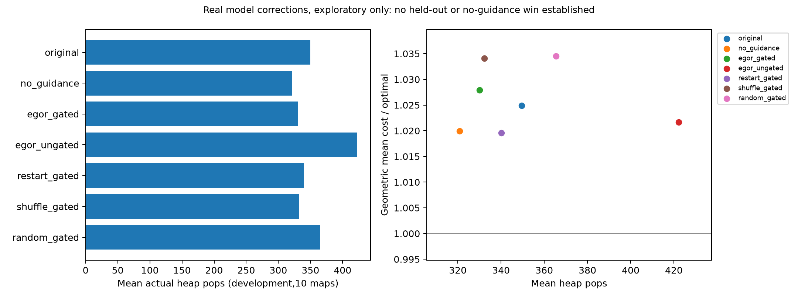

# Session5 — Real LLM guidance: a direct repair extension with inconclusive gains

**No reliable new winner is established.** We implemented and tested a direct
extension of the actual original LLM-A* algorithm: **Evidence-Gated Online Repair
(EGOR-A*)**. It receives real geometric/search feedback, requests at most one
correction and selectively updates the guidance. A small development reduction
in operations is not statistically confirmed, slightly worsens path quality,
and does not outperform the matched original engine without waypoints.

All new successful responses use **gpt-4o-mini-2024-07-18**. Original and improved
algorithms replay identical model outputs/parameters. Real requests are cached
with complete prompts,model,seed,usage,cost and latency. Original source, main
and previous experiment results are preserved. No push/merge. Candidate milestone
`b928a02` precedes the fresh OFFLINE correctness audit.

## 1. Academic framing and relation to the paper

The original university rubric was not found; we use the stated assignment goal
of improving an existing LLM-A* research method. The original paper's Algorithm1
matches the implementation: the LLM proposes targets, search scores

`f(n)=g(n)+h_goal(n)+d(n,t)`.

A generated neighbor can globally advance t before collision/CLOSED checks;
OPEN is rescored. At final t=goal the score is `g+2h_goal`. This is not admissible
A* in the usual optimality sense. Rapid switching and potentially invalid global
route sketches motivated earlier sessions. Prior evidence of quick target
consumption was reviewed rather than rerun without a new hypothesis.

The paper explicitly says its RePE receives no environment feedback. Our research
question is whether **selective external evidence and in-search correction**
can improve its guidance without replacing the original search architecture.
This addresses LLM-A* integration, not an unrelated classical speed optimization.
[Original paper, Algorithm1 and section3.3](https://arxiv.org/pdf/2407.02511).

Feedback planning itself is established: [ReAct](https://arxiv.org/abs/2210.03629)
uses interaction with external sources; [Self-Refine](https://arxiv.org/abs/2303.17651)
uses self-generated feedback. We claim an implemented/empirically studied
adaptation to LLM-A* with a concrete event and evidence gate, not invention of
LLM feedback or a verified novel state-of-the-art algorithm.

## 2. Method: Evidence-Gated Online Repair

`repair.repaired_class(Original)` subclasses the frozen original class. It keeps
its heuristic, neighbor-switch rule, CLOSED behavior and original parent costs.
No general search-engine fix is silently attributed to the new mechanism.

Let T be a proposal, I(T) its invalid-coordinate count, B(T) the number of
consecutive proposed links failing the two checked shortest lattice
interpolations, and L(T) the sum of consecutive octile distances. Define

`Q(T)=(I(T), B(T)/max(1,number_of_links), L(T))`.

This is an empirical lexicographic evidence score, **not a path-cost certificate**.
An interpolation failure is explicitly not called an unreachable waypoint.

Trigger one correction when a factual contradiction exists and the search has
not solved after16 expansions. Supply the actual invalid point/first colliding
edge plus current node,g,active target,OPEN size and expansion count. The LLM
returns revised guidance using the same model and1024-token cap. Accept only if
`Q(T_new) <lex Q(T_old)`. Preserve accumulated search work and rekey OPEN only if
the filtered target sequence actually changes. Failed/rejected corrections
continue classical search; original no-path extraction errors invoke a robust
no-LLM weighted fallback. The16-expansion threshold is a predeclared starting
setting, not a validated optimum.

Pseudocode suitable for the report:

```
T := initial_LLM(map,start,goal)
initialize_original_LLM_Astar(T)
used_correction := false
while OPEN not empty:
    pop and expand using original g+h_goal+d_target
    if contradiction(T) and expansions>=16 and not used_correction:
        used_correction := true
        T_new := LLM(map,T,concrete_failure,current_search_state)
        if parse_valid(T_new) and Q(T_new)<lex Q(T):
            if filtered_targets_changed:
                T := T_new
                rescore original OPEN; retain g,PARENT,CLOSED
    perform original target switching and relaxations
return valid reconstructed path, or classical no-guidance fallback
```

The class inserts the hook through `get_neighbor` after the original pop and
before neighbor expansion. No repeated arbitrary API interval. Original final-
goal weighting remains2. EGOR does **not** gain an optimality/suboptimality proof
merely by adding a verifier. Keeping original CLOSED can preserve a poorer path
than restarting; this is visible in the ablation.

## 3. Real-model experiments and model provenance

The historical Table1 notebook cells5/7/44 name the **gpt-4o-mini alias**. Its old
plain-string caches cannot establish the exact historical snapshot. We do not
relabel them as o4-mini. The user's final clarification selected the exact new
snapshot; authenticated model listing and an8-token probe confirmed availability.
All113 successful returned model IDs were checked against the exact snapshot.

New collection:10 development maps at sizes40/56 and10 separate validation maps
at48/64,10 diverse families. Original few-shot prompt is copied verbatim. Other
conditions: compact coordinates,endpoint IDs,ASCII and a single verified reachable
candidate. Temperature0,seed20261118,1024 completion cap shared across new prompt
conditions. Historical original code used1000; we use1024 consistently here.
Concurrent collection3 is recorded; API latencies are observations under this
collection setup, not isolated throughput guarantees. Every compared search
algorithm reuses the SAME response. Reference costs never enter model inputs.

A candidate prompt receives at most eight geometrically verified reachable
wall-endpoint options and chooses one. This guarantees executable target
coordinates by construction/filtering, **not good model route reasoning**.
Visibility/candidate construction is classical preprocessing and must be charged.
The original algorithm can consume these IDs through a deterministic coordinate
adapter without changing its search code.

## 4. Prompt-only and algorithm-only results

Frozen original search on ten development cases:

|Prompt|Mean unique|Mean heap pops|Cost/opt GM|
|---|---:|---:|---:|
|Original|230.8|349.6|1.02491|
|Compact coordinates|249.7|364.8|1.0319|
|Endpoint IDs|384.7|559.2|1.0190|
|ASCII+IDs|350.7|507.2|1.0219|
|One verified candidate|206.9|317.7|1.0299|

Compact syntax/IDs do not solve global route selection. The model often chooses
irrelevant walls, lists ends beyond the goal or produces a poor order. Dense
original responses sometimes truncate. The single-candidate prompt reduces
operations but slightly worsens cost; it is not a strict dominance result.

On separate validation maps, the original-code prompt/mechanism factorial is:

|Prompt|Frozen original unique/pops/cost GM|Path-consistent full unique/pops/cost GM|
|---|---|---|
|Original|617.6 /914.3 /1.01598|612.8 /1420.9 /1.00528|
|Single candidate|548.1 /824.1 /1.01856|581.3 /1313.5 /1.00996|

This is genuine real-model evaluation, with the same exact model. The new
path-consistent mechanism does not improve overall effort. It can shorten paths
while increasing pops. The shared unguided labelled engine has539.1 unique,
1319.7pops,cost1.00979. Do not attribute mere fallback to it to LLM knowledge.

The path-consistent hypothesis used immutable parent labels so a later ancestor
g improvement cannot invalidate reached-waypoint claims. Original/normalized/
bounded scoring, trust,path-length budgets and verified-prefix alternatives are
preserved. Its bounded score `H=2h-alpha*max(0,h-d_target)` lies in[h,2h]; with
better-g reopenings and real-cost labels it preserves factor2. Extra labels and
stage reexpansions make it unattractive here. Verified seeding also regressed
(candidate bounded seed275.7states,costGM1.0524 on development).

## 5. Direct EGOR results and ablations

Ten development cases, exact original code with matched indexed geometry,
seven shuffled offline timing repeats. Eight genuine online corrections were
requested,seven changed the filtered plan. The same successful correction is
reused for gate/no-gate,restart and synthetic quality controls:

|Original-code variant|Mean heap pops|Mean distinct|Cost/opt GM|Offline compute ms|
|---|---:|---:|---:|---:|
|Original|349.6|230.8|1.02491|10.075|
|Same original WITHOUT guidance|320.8|208.8|1.01997|9.781|
|**EGOR, evidence gated**|**330.1**|**225.3**|**1.02789**|**9.716**|
|Ungated correction|422.2|294.4|1.02167|12.480|
|Restart after same gated correction|340.2|225.3|1.01959|9.822|
|Shuffled corrected intermediate targets|332.2|226.8|1.03409|9.757|
|Random equally sized free intermediate targets|365.4|244.3|1.03453|10.478|

Shuffle/random retain start,goal and intermediate count. A no-op hook exactly
matches original counts. Restart is charged the ACTUAL initial16 expansions
before discarded work, plus the entire restarted search. Reusing CLOSED saves
some operations but produces worse cost than restart. Avoid calling that an
unqualified improvement.

EGOR/original pop ratio0.9442,95% development-map bootstrap[0.7423,1.0728].
EGOR/no-guidance1.0290,[0.9307,1.4376]. The mean5.58% reduction is inconclusive
and trades away some path quality. The evidence gate protects against one harmful
correction in this pilot; ungated replacement is worse on average. Shuffle is
almost tied, so route-order utility is not established. These are exploratory
unadjusted intervals from only10 maps and one real output/query, not evidence of
reliable generalization or an LLM-specific victory over classical search.

A successful preflight feedback experiment on the matched contradicted subset
showed original-prompt unique281.25→264.38 and pops429.75→400.12 across8 cases;
endpoint9 cases424.44→411.56unique. Generic preflight self-review was worse. This
is a separate preliminary condition with no online context; it cannot substitute
for the online generic control below.

**The eight online generic-self requests failed transport.** They produced no
new model outputs. Their unchanged baseline results are NOT a completed
self-review comparison and are not used to claim targeted feedback superiority.

## 6. Runtime, cost and remaining evidence gaps

Mean initial API latency7.679s; correction API2.093s per query averaged over all10;
measured online search loop including correction2.131s. Initial API plus online
loop derives9.810s, before some initial prompt/setup work. It is a derived sum,
not an independently measured full application transaction. Offline replay
milliseconds exclude network; compare them only with other offline variants.
EGOR does not improve end-to-end latency here.

Budget guard uses atomic integer-nanoUSD reservations of full128k context input
plus capped output. Unknown/failed requests retain their worst-case reservation;
no automatic retries or budget reset on checkout. Successful responses are
cached before accounting and portable export restores the ledger. Pricing from
[official model documentation](https://developers.openai.com/api/docs/models/gpt-4o-mini)
checked Nov18: input$0.15/M,cached$0.075/M,output$0.60/M.

|API metric|Value|
|---|---:|
|Authorized maximum|$3.00|
|Confirmed successful requests|113 (112 research +1 probe)|
|Failed/uncertain requests|8|
|Known usage-based estimate|$0.02871540|
|Conservative unknown-cost hold|$0.15851520|
|Known plus maximum held exposure|$0.18723060|
|Remaining authorization after holds|$2.81276940|
|Input tokens,including cached|92696|
|Cached subset|24064|
|Output tokens|27693|
|Reported reasoning tokens|0|

Reasoning tokens would be counted inside completion tokens, not double billed.
Failed-request billing is not claimed to be zero. Six URLError,one timeout and
one remote disconnect affected the generic online control. A later FREE model-
list check hit an automatic approval-review deadline, not a safety denial.
No further API calls were attempted. No credential values/auth headers entered
source/logs/commits; tracked/decompressed artifact scan passed. Codex auth intact.

Consequently **a fresh held-out REAL-model evaluation was not completed**. A
frozen fresh offline correctness audit has20 queries/10 new maps,80 bounded
random-target paths and6312 Shapely-verified edges. That is labelled synthetic
correctness only, not an LLM performance result. Geometry is disjoint from
Session5 dev/validation and Session4 dev/fresh. There are no invented held-out
model results, no repurposed old answers passed off as new-map guidance.

## 7. Engineering checks and academic conclusion

Original source and main unchanged; independent local commits preserve new
mechanisms and all responses. Budget/cache/failure/restore tests, immutable
ancestry, bounded quality, goal weighting, dynamic rekeys and direct original
repair/unreachable fallback are tested. Separate30 exact heap/memory trials
match replay pop counts; heap pushes and retarget rekeys are retained in
`heap_audit.json`. Traced allocations are not full process RSS. Repeated offline
timings do not measure model stochasticity; only one real seed/query was collected.

**Research problem:** LLM-A* accepts uncertain initial plans without external
search-informed correction and globally changes guidance across branches.

**Hypotheses:** External contradictions can improve bad suggestions; an evidence
gate can avoid blindly accepting self-corrections; branch-local progress can
avoid unrelated frontier interference.

**What is supported:** The mechanisms are implemented, reproducible and use real
responses. Some corrections reduce development effort; a geometric evidence gate
avoids a harmful revision in this sample. Branch-local progress alone is costly.
A constrained candidate prompt improves validity and sometimes reduces original
operations, with a measurable quality tradeoff.

**What is NOT supported:** Robust superiority over original LLM-A*, a matched
no-guidance algorithm, unseen maps or full runtime. EGOR is a research candidate,
not a confirmed new best algorithm. Do not market a 5.58% mean alone as success.

For the university submission, present an honest integration/empirical study:
formalize the original limitation, show all prompt/mechanism controls, explain
why grounded feedback is preferable to blind replacement, and retain negative
results. Keep Session4's classical improvement separate. The strongest next step
is a frozen, map-disjoint live EGOR study with a successful equal-call generic
control and explicit cost/quality criteria. Existing budget/export/checkpoint
allow it to resume without recollecting completed responses.

[Exact commands and continuation rules](../../research/session5/README.md).
[Tables and paired intervals](analysis/TABLES.md).
[Full statistical/latency records](analysis/statistics.json).



[Standalone PDF](analysis/repair_tradeoffs.pdf).

An important extra accounting result: the separate heap audit finds **more total
heap API calls despite fewer pops**. Original averages625.2 pushes,349.6 pops,
4.6 retarget rebuilds; EGOR746.9 pushes,330.1 pops,8.7 rebuilds. Push+pop calls
rise974.8→1077.0,about10.5%. No-guidance has390.5pushes,320.8pops,no rebuilds.
Mean traced allocations0.11307MiB original,0.11383EGOR,0.09068no-guidance on this
small sample. Therefore the paper-style operation reduction is not a verified
overall heap-work,memory or runtime improvement.

Final automated suite: **128 passed**; compile checks succeed. The final wrapper
also handles the original's trivial start=goal extraction/indexing failure and
unreachable extraction failure through a no-LLM fallback. This robustness-only
patch follows the candidate milestone and does not affect any reachable distinct-
endpoint research comparison or change the frozen original file.
