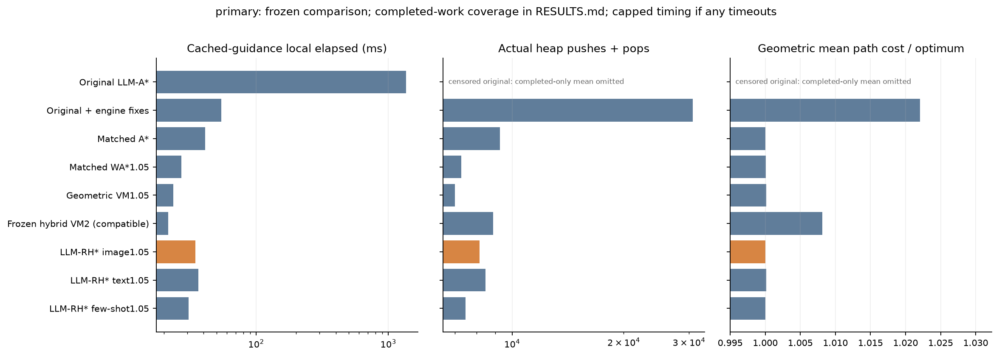
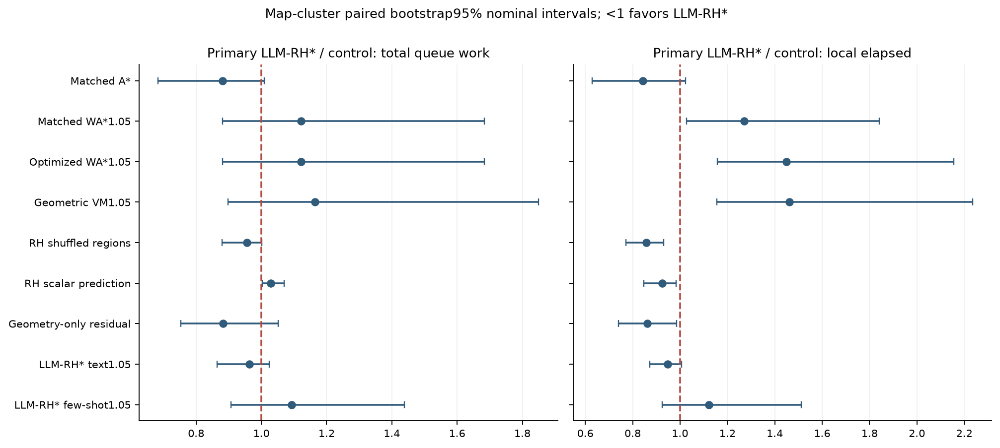
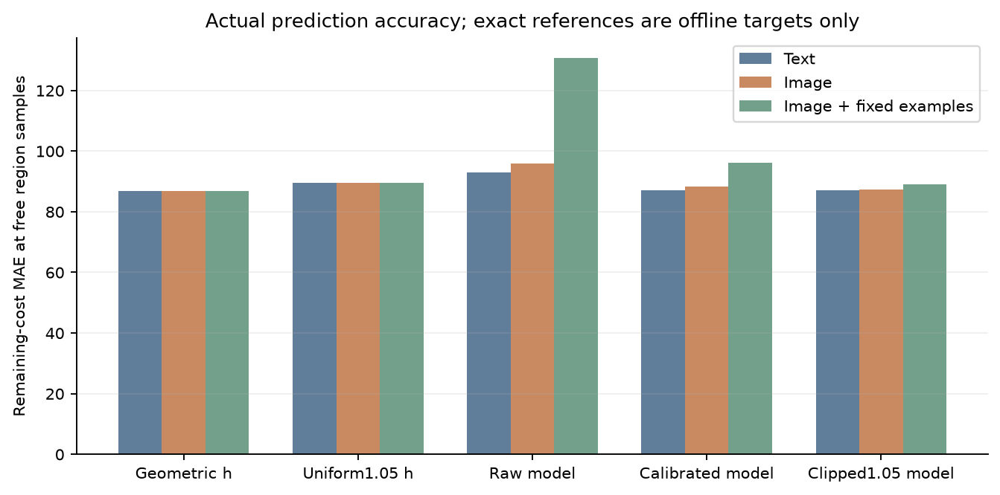
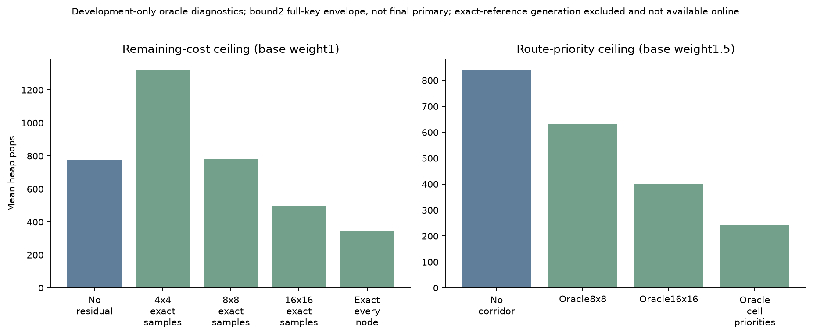
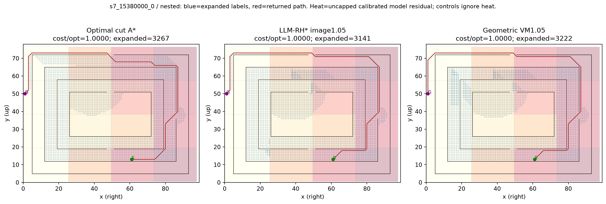

# Session 7: persistent LLM spatial residuals for bounded A*

Research branch: research/waypoint-guidance. Model: gpt-4o-mini-2024-07-18.
Work began on 19 November 2026 and continued on 20 and 21 November after
interruptions.
Interruptions are excluded from active duration. Final timing and publication
status are recorded below and in CHECKPOINT.md.

## Research question and contribution

Can a general-purpose language model improve A* by predicting reusable spatial
remaining-cost information, rather than transient waypoint coordinates? The
university objective is to improve the original LLM-A* method, not to relabel a
classical speed optimization as an LLM contribution. The actual assignment PDFs
were reviewed: reproduce the original comparison, evaluate on hidden maps, and
develop a defensible improvement. No additional assignment requirements are
inferred. This extended research report is supporting material, not a claim to
be the required five-page ACL-format final submission.

Our experimental contribution is **LLM-RH***: validated regional residual
predictions, one development-only trust calibration, and an independent
pointwise heuristic envelope. Advice persists across the search, avoiding the
original incompatibility between quickly switched waypoints and a delayed
stagnation controller. This is an adaptation/integration of established bounded
heuristic search and learned cost guidance, not a claim to invent Focal Search,
pathmax, multi-heuristic search, or universally novel heuristic learning.

A useful scientific result must isolate actual model information from ordinary
heuristic inflation, geometric preprocessing, queue fixes, and different path
quality. Accordingly, every major pilot has no-model and geometric controls;
final tests additionally include uniform weighting, shuffled advice, scalar
advice, macro integration, modality, calibration and in-context-learning controls.
The frozen Session 6 LLM-A-VM* remains independently runnable and unmodified.

## Original algorithm and observed limitation

The paper proposes obtaining sparse routing points from an LLM and using them
to guide incremental heuristic search. The frozen implementation uses
`f=g+h_goal+d_target`, with Euclidean goal/target distances. At the final target
this becomes `g+2*h_goal`. The target advances when it appears as a generated
neighbor, before collision/CLOSED checks. Duplicate heap entries are processed
by the original list-based CLOSED engine. These details remain reproducible.

Source: llm-astar/llmastar/pather/llm_a_star/llm_a_star.py, target initialization
lines65-86, neighbor/switch/search lines121-144, queue rebuild lines162-166,
heuristic lines190 onward. Existing corrected/adaptive implementations and
previous research documents retain the distinction between baseline scoring,
search-engine repairs and waypoint-specific adaptation. A short active target
lifetime gives a30-expansion stagnation detector little opportunity to act.
Distance stagnation can also mistake a necessary obstacle detour for failure.
The original waypoint filter (lines99-104) is stricter at the interior border
than legal search cells after range mutation, so some legal boundary-adjacent
waypoints are discarded. This is preserved rather than silently repaired in the
baseline or its bounds-prompt control.

The new method changes the scoring formula explicitly, with a separate class;
it does not silently weaken the original final-goal heuristic. Natural-language
query parsing remains outside this research interface: original structured map
dictionaries or their JSON representations are accepted. Original result keys
are retained, and dense paths plus detailed metrics are added. For the regional
method, llm_output is a compatibility endpoint list, not a claim that the model
generated coordinate waypoints; actual advice is in field_predictions and
guidance_type. Do not score those compatibility endpoints as model accuracy. An explicit
provider is required for online calls; offline replay itself makes none.

## Method and mathematical formulation

Partition the integer interior into4x4 regions. Geometry chooses a free sample
per region. The model receives exact coordinates, region bounds/identifiers,
start/goal, obstacles or a rendered image, and an admissible geometric lower
bound at the samples. It predicts additional remaining distance delta>=0,
confidence c in[0,1], and a separate route priority. The selected cost method
uses delta and confidence; priority is used only by separately labelled pilots.
Malformed, duplicate, nonfinite or unknown records are rejected; absent guidance
becomes zero. No test path or reference remaining cost enters a model prompt.

Let h be the geometric cut lower bound, with octile fallback, and a the global
trust coefficient. The selected heuristic is:

```text
H(n) = h(n) + min((w-1)*h(n), a*c[region(n)]*delta[region(n)])
F(n) = g(n) + H(n)
alpha_effective(n) = min(a*c[region(n)], (w-1)*h(n)/delta[region(n)])
```

The last expression applies when delta>0; zero residual gives zero contribution.
This makes trust spatial and dependent on remaining distance without waiting
for a stagnation timer. Predictions are static during the primary search:
**no online alpha-learning, guidance revisions or OPEN rebuilds are claimed**.
The effective multiplier is bounded by the independent envelope and the extra
term vanishes at the goal. The fixed global coefficient is supervised scalar
calibration, not language-model fine-tuning or a wholly training-free system.

Using development-only exact residuals y=(C*-h)/map_diagonal and model values
x=c*delta/map_diagonal, set a=clip(sum(x*y)/sum(x*x),0,1). Final image
coefficient 0.22640953779865894 and text coefficient 0.07056526284991615 are frozen.
Primary w=1.05, base_weight1, no macros. Secondary w=2 is a separate quality
profile. Raw-alpha 1, geometric-interval, few-shot and macro versions are ablations.

```text
REGIONAL-RESIDUAL-ASTAR(query, provider_or_cached_response, a, w):
    build grid, geometric anchor, and geometry-only region representatives
    validate one regional model response; replace unusable records by neutral advice
    OPEN <- start label with g=0 and priority g+H
    while OPEN is not empty:
        pop minimum-priority immutable label
        skip outdated or already-closed nonimproving labels
        close or reopen the state at the improved actual g
        if goal: reconstruct the actual dense path; return
        for every legal ordinary grid successor:
            if actual accumulated cost improves best known g:
                create immutable parent label; push with g+H(successor)
    return no path
```

All ordinary transitions remain and better-cost paths reopen. Since
h<=H<=w*h<=w*C*, an optimal-path frontier label has key at most w*C*_start;
the popped goal has H=0 and no larger key. Returned cost is thus at most
w*optimum under the admissible-anchor, finite-grid and nonnegative-cost
assumptions. At w=1 it reduces to optimal A*. Predicted values themselves need
not be admissible or consistent. A benchmark time cap can interrupt completion;
it is not part of the uncapped guarantee. Optional macro-edges are actual
collision-checked lattice walks with their true cost, preserving the same grid
optimum and bound. See session7/THEORY.md for full details.

## Data separation and frozen protocol

Development:20 instances, ten families. Canonical-geometry audit found that six
reuse recognizable earlier geometries; they are allowed as development only.
Validation:30 distinct, independently seeded maps, disjoint from training and
known previous maps. Do not describe all development geometry as untouched.

The final algorithm, prompts, coefficients and source hashes were frozen at
2026-11-20T09:41:18UTC **before** test map generation. Main set:80 queries on 40 new
geometries, ten families, generator sizes97/131/163/197. Large stress:20 queries
on 20 additional geometries, sizes227/263. The ten families are open, random walls,
rooms, braided maze, tree maze, serpentine, U traps, nested obstacles, competing
corridors and bottlenecks. Easy maps remain in every aggregate. Equal geometry
is clustered irrespective of map names; no recognized prior/training overlap
was found. Generation and reverse-Dijkstra reference work are offline evaluation
costs, never supplied as inference inputs or treated as free search operations.

Forty separate third queries on primary geometries are reserved for actual
latency calibration, not algorithm selection. Teacher examples are two fixed
development maps; no held-out solution or response is used for prompt refinement.
Additional true-response seed sensitivity uses ten validation maps, three seeds,
and is separate from repeated timing of one cached response.

## Fair comparisons, timing and baseline compatibility

The native benchmark uses identical query/response caches, fresh query-local
preprocessing, one method warmup, five measured native repetitions, randomized
method order, and a separate instrumented heap/path audit. Every method has the
same five-second cap. Censored runtimes contribute their measured cap and are
reported with completion coverage; failed audits never contribute zero work.
Five shuffled-region seeds are averaged within a query, not counted as five
independent maps. Paired intervals resample whole canonical map geometries;
intervals are nominal and not corrected for searching many experimental variants.

Controls include frozen original and robust original on the same waypoint reply,
optimal octile/cut A*, Weighted A*, Witness-First, frozen VM with and without
model guidance, the same residual engine with zero/uniform guidance, optimized
uniform control, calibrated/raw text/image, few-shot, shuffled/scalar fields,
geometry-only interval residuals, and residual-plus-macro integration. Path
quality is checked against the same independent optimal reference. Comparing
the original with regional search changes both representation and algorithm;
there is no fabricated fully crossed factorial between incompatible formats.
The bounds-only original prompt control is conservative, while raw/calibrated/
few-shot regional variants isolate changes inside the same search engine. Better results
than the frozen original do not establish additional LLM value.

Cached-guidance planning includes geometry, field construction/parsing and search.
First-use image/prompt CPU and actual API/client latency are measured separately;
replay milliseconds are never presented as online end-to-end latency. Tracemalloc
and cProfile are separate diagnostics, excluded from native timing claims.
Traced Python allocations are not total RSS. Paper operation=count of popped
CLOSED entries and storage=len(g) are preserved separately from distinct states,
actual pushes+pops and allocated memory. Storage ratio is not a byte ratio. The old g dictionary also retains infinite-cost
blocked-neighbor entries, whereas the new best-label table stores discovered
finite labels; raw SR therefore cannot establish a proportional memory saving.
Heap audits include portfolio preprocessing, while paper-style operation remains
the separately reported search-pop count. Original scoring/queue behavior is
frozen; an equivalent analytic collision backend is shared for fair computation,
as in the previous-session harness, and all saved paths receive independent
closed-segment checks.

A provider limit was discovered on newly large VM problems: strict schemas allow
at most1000enum values. Literal frozen VM remainsvm_strict2, with its original
provider-error geometric fallback. A stronger separately labelledvm_hybrid2
control keeps all candidates, prompt, decoder and search, removing only an
unsupported schema enum constraint and validating returned IDs afterward.
Compatible responses are never replayed into the literal baseline. No candidate
truncation or silent baseline repair is used. The HTTP400 cost reservation is
retained conservatively. See BASELINE_COMPATIBILITY.md and original-bounds
prompt control on 20size-selected cases.

## Development evidence and rejected directions

Oracle experiments identify both model and representation limitations. Fine
oracle residuals reduce development pops 342.3 versus 774.15 optimal cut-A*;
fine oracle path priority242.2. But4x4 sample-oracle residuals require1320.15 pops,
8x8: 780.15,16x16: 498.5. Coarse perfect-at-sample values can still be poor advice
elsewhere. Oracle mask8x8gives631.3 versus 839.5 matched no-mask weighted search.
Oracle work is explicitly labelled and excluded from model-use claims.

Actual route-mask prompts on 20 maps were worse than the matched no-model engine:
coordinate1576,structured1559,ASCII1695,image 1786,labeled image 1296,hybrid1663
pops versus 839.5. Exact region grounding and disjoint few-shot examples did not
recover a reliable advantage. Numeric residual prompting was more promising:
image 650.75versus774.15zero-residual A*, but fixed Weighted A*1.05needed565.35.
Prediction MAE was worse than the geometric lower bound. Calibration moderates
errors, but does not by itself demonstrate useful extra information.

Validation shows the danger of a pop-only headline: tight image residual has
917.73 pops versus 953.03uniform1.05, but748.1versus587.1 unique expansions and
2162.6versus2108.27total queue operations. Additional residuals on an already
weighted anchor did not help generally. Geometry-verified residual intervals
add witness-building CPU and did not justify selection over simple calibration.

Other tested hypotheses: persistent obstacle-side potentials failed even at
oracle level; sparse landmark forced-route and difference estimates added too
much visibility overhead; rectangular masks had little headroom over strong
weighting. Actual policy selection always chose the same cut 1.05 forward policy,
which a constant classical controller reproduces without a call. Semantic sanity
requests confirm the API can honor other requested policies. A controller oracle
has headroom, but actual responses did not realize it.

One search-aware feedback pilot triggers only on 128 unique expansions plus two
legal-edge inconsistencies exceeding the geometric anchor's own discrepancy.
Three of 20 maps triggered. Targeted and generic review both gave625.45 mean pops
versus 631.45initial, with additional seconds of API latency. This is too small a
pilot to claim a general benefit; same-output-resolution oracle correction was
not reliably better. An early local damping bug omitted the global coefficient;
its source/results are archived asv1 and excluded from decisions, with corrected
v2retained. Late policy-discrepancy and bounded-pathmax integration are separate
development/validation studies, not post-hoc retuning of the frozen final method.

## Final empirical results

Local runtime uses monotonic perf_counter wall-clock measurements, not operating-system process CPU seconds. CPU in diagnostic labels means elapsed local computation.

The frozen candidate **does not outperform the strong matched classical control**. It is a verified bounded integration experiment, not a successful claim that general-purpose LLM predictions accelerate this task. Frozen VM remains the stronger submission fallback. The original has26 audit timeouts; comparing its completed-only work mean with all 100 new successes would be invalid.

### 80 primary queries /40 map geometries

| Method | Valid queries | Cached planning ms | Push+pop | GM cost/opt |
|---|---:|---:|---:|---:|
| Original LLM-A* (5s cap) | 64/80 | 1355.43 (capped) | censored | 1.03448 |
| Original + engine fixes | 80/80 | 54.51 | 30750.0 | 1.02209 |
| Matched cut A* | 80/80 | 40.93 | 9267.7 | 1.00000 |
| Matched WA*1.05 | 80/80 | 27.18 | 7274.8 | 1.00006 |
| Geometric VM1.05 | 80/80 | 23.63 | 7006.7 | 1.00014 |
| Geometric VM2 | 80/80 | 23.08 | 8863.4 | 1.00822 |
| Frozen hybrid VM2 (compatible) | 80/80 | 21.49 | 8880.5 | 1.00815 |
| LLM-RH* image 1.05 | 80/80 | 34.53 | 8161.9 | 1.00003 |
| LLM-RH* image 2 | 80/80 | 36.31 | 8379.5 | 1.00074 |
| RH fixed few-shot 1.05 | 80/80 | 30.76 | 7469.2 | 1.00003 |

Original path means use completed audits only; all other listed methods complete every query. Capped means include actual measured timeout durations. Full raw tables retain completed-work coverage, medians, p95, distinct states, stale/reopened pops and paper OR/SR.

| Primary RH / control | Queue-work ratio [95%CI] | CPU ratio [95%CI] |
|---|---:|---:|
| Matched cut A* | 0.881 [0.684, 1.009] | 0.844 [0.629, 1.024] |
| Matched WA*1.05 | 1.122 [0.881, 1.684] | 1.270 [1.027, 1.841] |
| Geometric VM1.05 | 1.165 [0.898, 1.850] | 1.462 [1.156, 2.235] |
| RH shuffled regions | 0.956 [0.880, 1.002] | 0.858 [0.771, 0.930] |
| RH scalar residual | 1.028 [1.003, 1.070] | 0.924 [0.847, 0.984] |
| LLM-RH* text 1.05 | 0.963 [0.864, 1.025] | 0.947 [0.873, 1.006] |
| RH fixed few-shot 1.05 | 1.093 [0.907, 1.439] | 1.123 [0.925, 1.513] |

Ratios below1favor primaryRH. Intervals resample whole geometries, retaining paired queries; they are nominal, conditional on cached model responses, and not multiple-testing corrected.

### 20large stress queries /20 map geometries

| Method | Valid queries | Cached planning ms | Push+pop | GM cost/opt |
|---|---:|---:|---:|---:|
| Original LLM-A* (5s cap) | 10/20 | 2800.67 (capped) | censored | 1.02442 |
| Original + engine fixes | 20/20 | 238.28 | 143786.2 | 1.01114 |
| Matched cut A* | 20/20 | 181.51 | 40660.9 | 1.00000 |
| Matched WA*1.05 | 20/20 | 124.68 | 34251.4 | 1.00035 |
| Geometric VM1.05 | 20/20 | 112.52 | 33528.4 | 1.00035 |
| Geometric VM2 | 20/20 | 106.95 | 49666.8 | 1.01759 |
| Frozen hybrid VM2 (compatible) | 20/20 | 107.03 | 49903.6 | 1.02117 |
| LLM-RH* image 1.05 | 20/20 | 191.42 | 43443.7 | 1.00066 |
| LLM-RH* image 2 | 20/20 | 189.93 | 42322.7 | 1.00137 |
| RH fixed few-shot 1.05 | 20/20 | 168.67 | 36223.0 | 1.00035 |

Original path means use completed audits only; all other listed methods complete every query. Capped means include actual measured timeout durations. Full raw tables retain completed-work coverage, medians, p95, distinct states, stale/reopened pops and paper OR/SR.

| Primary RH / control | Queue-work ratio [95%CI] | CPU ratio [95%CI] |
|---|---:|---:|
| Matched cut A* | 1.068 [0.972, 1.169] | 1.055 [1.011, 1.089] |
| Matched WA*1.05 | 1.268 [0.898, 3.488] | 1.535 [1.113, 3.368] |
| Geometric VM1.05 | 1.296 [0.905, 4.043] | 1.701 [1.179, 4.241] |
| RH shuffled regions | 0.992 [0.974, 1.011] | 0.940 [0.863, 1.017] |
| RH scalar residual | 1.049 [0.999, 1.143] | 0.953 [0.903, 0.994] |
| LLM-RH* text 1.05 | 1.065 [0.974, 1.165] | 1.031 [0.982, 1.110] |
| RH fixed few-shot 1.05 | 1.199 [1.024, 1.576] | 1.135 [1.006, 1.472] |

Ratios below1favor primaryRH. Intervals resample whole geometries, retaining paired queries; they are nominal, conditional on cached model responses, and not multiple-testing corrected.

### What the ablations establish

Few-shot examples reduce aggregate work/runtime here, but do not establish superiority to uniform 1.05. Primary-set intervals are wide. All 1600 few-shot confidence values become 1, while numerical MAE worsens; the examples themselves have confidence 1. Response imitation/greater inflation is a plausible explanation, not proven better spatial understanding. Numeric calibration, modality and placement have separate controls; a gain over optimal A* alone can merely be heuristic inflation.

- Few-shot RH / uniform 1.05, primary queue ratio: 1.027 [0.938, 1.247].
- Few-shot RH / uniform 1.05, large queue ratio: 1.058 [0.779, 2.704].

See tradeoffs.json for all-family wins/losses and explicitly identified worst regressions; extrema are illustrations, never favorable-case selection.

- primary: queue wins/ties/losses=21/6/53; median per-case queue ratio=1.101; worst ratio=15.886. Queue gain without worse path occurs in 21/80completed pairs.
- large: queue wins/ties/losses=8/0/12; median per-case queue ratio=1.046; worst ratio=25.452. Queue gain without worse path occurs in 7/20completed pairs.

### Why useful oracle information is not enough

Safety and resolution are independent bottlenecks. On validation, exact-every-node residuals under the primary pointwise 1.05 envelope need 2781.7queue operations, versus 2108.27 for uniform 1.05. The same fine information under the full-key 2 envelope needs 1715.6. A trusted perfect-admissible cost oracle needs 1526.8, but its offline reference computation and known admissibility are unavailable to unchecked model outputs.

Thus even perfect local information can be poorly exploited by a tight envelope. Focal fine-oracle2reduces unique expansions to 315.4but needs 3438.8queue operations. Neither fewer unique states nor oracle success alone establishes computational improvement. Coarse4x4 sample-oracle fields also remain weak, demonstrating information loss inside regions. No new real-model claim is made from these oracle experiments.

### Late alternatives, including a rejected floating-point artifact

#### discrepancy_pilot / development

| Variant | Mean queue operations | Mean unique states |
|---|---:|---:|
| none | 6258.4 | 627.0 |
| real | 5982.3 | 612.1 |
| shuffled | 7446.2 | 734.2 |
| uniform 105 | 1317.1 | 411.4 |

#### discrepancy_pilot / validation

| Variant | Mean queue operations | Mean unique states |
|---|---:|---:|
| none | 9562.3 | 924.6 |
| real | 9039.8 | 907.0 |
| shuffled | 10438.2 | 1018.2 |
| uniform 105 | 2108.3 | 587.1 |

#### pathmax_v2 / development

| Variant | Mean queue operations | Mean unique states |
|---|---:|---:|
| none / pathmaxFalse | 1936.2 | 643.6 |
| none / pathmaxTrue | 1936.2 | 643.6 |
| real / pathmaxFalse | 1426.8 | 471.8 |
| real / pathmaxTrue | 1413.2 | 451.1 |
| shuffled / pathmaxFalse | 1533.5 | 497.6 |
| shuffled / pathmaxTrue | 1462.5 | 463.9 |
| uniform 105 / pathmaxFalse | 1317.1 | 411.4 |
| uniform 105 / pathmaxTrue | 1317.1 | 411.4 |

#### pathmax_v2 / validation

| Variant | Mean queue operations | Mean unique states |
|---|---:|---:|
| none / pathmaxFalse | 2839.0 | 982.0 |
| none / pathmaxTrue | 2839.0 | 982.0 |
| real / pathmaxFalse | 2162.6 | 748.1 |
| real / pathmaxTrue | 2061.4 | 715.5 |
| shuffled / pathmaxFalse | 2475.2 | 811.7 |
| shuffled / pathmaxTrue | 2051.5 | 709.5 |
| uniform 105 / pathmaxFalse | 2108.3 | 587.1 |
| uniform 105 / pathmaxTrue | 2108.3 | 587.1 |

Discrepancy converts genuine predictions into a local successor policy and accumulates departures from it. Its model signal is modest compared with the same policy without guidance, but multi-queue overhead and expansion counts remain far above strong uniform search. Pathmax uses established nondecreasing-F regularization with an independent upper clip; it does not establish LLM-specific value merely by approaching uniform search or matching shuffled advice. Neither late candidate was promoted or tuned on final maps.

The initial pathmax copy changed arithmetic association and hence floating plateau tie order, producing apparent changes even with zero meaningful updates. Its v1source/results are archived and excluded. Corrected v2preserves frozen key arithmetic exactly when disabled and suppresses raises<=1e-12. Unsaturated-field parity and no-phantom-update regression tests cover the issue. This is a concrete reason to require identical search engines in heuristic comparisons.

### Prediction quality, effective trust, and waypoint behavior

| Input | Geometric MAE | Raw model MAE | Calibrated MAE | Clipped1.05 MAE |
|---|---:|---:|---:|---:|
| text | 86.90 | 92.90 | 87.11 | 87.10 |
| image | 86.90 | 95.98 | 88.23 | 87.31 |
| icl | 86.90 | 130.78 | 96.09 | 89.07 |

These are free regional representative samples with reachable exact references, not a claim of calibrated whole-region predictions. See residual_confusion for hallucinated extra cost when true residual is zero, correlation with lower-bound distance versus actual extra cost, and reported confidence on large errors. Mean per-query fraction of expanded states at the primary safety cap is 0.183. Effective alpha varies by state; static predictions cause zero online alpha adjustments and zero guidance queue rebuilds.

Original completed intermediate target events=188; median active CLOSED pops=8.50; fraction shorter than 30=0.739. These are completed lifetimes only; unreached intermediate targets at termination are censored and explicitly retained in the raw audit. Duplicate CLOSED pops are not unique expansions.

Three genuine temperature0response seeds were tested on ten hash-selected validation maps. Distinct response counts and per-map search variation are retained in guidance_audit/seed_search.json.gz; native timing repeats are never presented as independent model outputs.

### Actual computational and online costs

Native phase records separate grid/region/parser/portfolio preparation and search. Lazy lower-bound and advice evaluation occur inside search and must not be added a second time. Prompt/image rendering was timed separately after warmup, with three repetitions and fresh query data.

| Preparation | Mean CPU ms | Median CPU ms |
|---|---:|---:|
| structured | 7.87 | 1.46 |
| image | 91.19 | 43.03 |
| icl | 91.53 | 43.66 |

| Search component (primaryRH, main set) | Mean ms |
|---|---:|
| grid_seconds | 0.096 |
| region_seconds | 2.049 |
| prediction_parse_seconds | 0.021 |
| preprocess_seconds | 0.865 |
| search_seconds | 30.857 |
| heuristic_seconds | 4.467 |
| guidance_seconds | 1.716 |

Search time includes lower-bound/guidance components. Cached provider reading is not an API call. First-use prompt+search sums are estimates across separately measured phases, not actual end-to-end trials. The following are actual online measurements on six reserved queries, deterministic shuffled method order, with process/font startup warmed but all query preparation, ledger/cache work and model latency included.

| Actual live method | Queries | Mean seconds | Median seconds |
|---|---:|---:|---:|
| original | 6 | 15.618 | 14.754 |
| rh_image105 | 6 | 9.189 | 7.905 |

This small latency calibration is not a representative server-latency race. Original CPU can dominate difficult examples; regional model calls still take seconds, whereas the geometric-only control needs milliseconds. No online model speedup over classical controls is established.

### Memory and profiling

Incoming response caches are preloaded equally and excluded from per-planning allocation measurements. The following are Python traced peaks, not whole-process RSS; timeout/failed profiles are excluded with completion coverage. Instrumented elapsed times are never native runtimes.

| Method | Completed profiles | Median peak KiB |
|---|---:|---:|
| Original LLM-A* (5s cap) | 13/14 | 1359.94 |
| Original + engine fixes | 14/14 | 1620.77 |
| Matched WA*1.05 | 14/14 | 2376.19 |
| Optimized WA*1.05 | 14/14 | 1956.55 |
| LLM-RH* image 1.05 | 14/14 | 3697.68 |
| Geometric VM1.05 | 14/14 | 1529.64 |

cProfile summaries and top call tables isolate actual heap self time, geometry/lower-bound work and Python search overhead. Across completed diagnostics the median heap fraction of profile self time is 1.22%. Fractions are profiled diagnostics on fixed-hash examples, not native timing claims or an assertion that every case has the same bottleneck.

### Correctness and actual API expenditure

Saved native/control/paper audit paths independently checked=4217; closed-segment edges checked=1105593. This counts stored configuration paths, not independent map samples. Every returned valid path passed integer/bounds/endpoints/neighbour/collision/recomputed-cost and declared quality-bound checks. Reverse-Dijkstra confirmed all 100held-out optimal reference costs. Independent Shapely-only Dijkstra added300searches on 100small maps and checked9888 reachable anchor values. Existing adversarial stress retained1120runs on 240 maps with 8164 additional edge checks. Final full-suite count is recorded in QUALITY_AUDIT.json.

Cumulative successful estimated charges=$1.47216705; unresolved worst-case exposure=$0.1977456; total exposure=$1.66991265, below$3. Session 7 successful estimated charges=$1.20418425, successes=905, input tokens=7442139, output=281031, cached-input subset=1076736, reasoning=0. No open requests remain. Unknown-cost holds are retained, not reset or concealed. All successful Session 7 responses identify the exact requested snapshot.

| Generation condition | Calls / queries | Mean cost USD/query | Mean recorded HTTP seconds/query |
|---|---:|---:|---:|
| heldout_baselines/original | 100/100 | 0.000809 | 7.735 |
| heldout_baselines/vm | 56/100 | 0.000598 | 1.822 |
| heldout_cost/image | 100/100 | 0.001715 | 6.840 |
| heldout_cost/structured | 100/100 | 0.001456 | 7.624 |
| heldout_icl/image | 100/100 | 0.002259 | 7.287 |

Original responses hit the retained1000 output-token cap 29/100 times. Compact cost replies all finish, but image/text each contain one rejected regional entry, safely retaining15/16valid records. VM avoids calls on 44/100geometry-certified cases; the compatibility schema is needed on 8/100 cases and those responses contain unknown endpoint IDs, rejected by the unchanged decoder. This separates syntactic constrained-output validity from strategic usefulness. No prompt is retuned in response to these final observations.

### Recommendation for the university project

Retain frozen **LLM-A-VM*** as the practical submission fallback, explicitly reporting the geometry-only ablation. The high-quality geometric VM1.05control is strong on these fresh tasks. Present **LLM-RH*** as a mathematically bounded, persistent spatial-guidance extension plus a rigorous negative empirical study. Do not claim that genuine model predictions explain the classical speed gains. Few-shot improvement within the new method is useful evidence, but not superiority to the matched no-model algorithm.

The central defensible contribution is an investigation of trustworthy integration: replace transient point attraction by reusable cost advice; separate model estimates from a proven quality envelope; expose where information resolution, prediction errors, safety restrictions and queue overhead defeat the hoped-for improvement. Existing neural/focal/pathmax techniques are acknowledged. A stronger next research direction needs demonstrably better fine-grained information or an architecture that can exploit it safely; another blind waypoint-weight sweep is not supported.

For the remaining deadline, prioritize the five-page academic report, reproducible tables, formal assumptions and honest ablations rather than new uncontrolled tuning. Three team roles can cover method/theory, independent reproduction/statistics, and report/presentation. Publication remains withheld because existing commit email lacks a verified account association; no authentication, identity, main/dev branch or historical commit metadata is changed.

### Standalone figures









### Post-unblinding VM contribution robustness check

This separately labelled block repeats frozen methods with no new model calls. Its timing window is separate from the main run; do not pool absolute times across blocks. It tests whether shorter candidate lists, rather than spatial intelligence, explain small VM timing differences. Actual, geometric-consensus, all-endpoint, abstaining and three count/overlap-preserving shuffled controls share the same portfolio, weights, collision checks and engine.

Geometry gates skip the model on 44/100 queries. It is called on 56; 13 of those leave no consensus targets. Only43/100 queries retain nonempty model targets. Retention is not proof that a model edge was accepted or beneficial.

#### VM robustness / primary

| Model VM / control | Queue ratio [95%CI] | Local-time ratio [95%CI] |
|---|---:|---:|
| vm_geo2 | 1.002 [0.993, 1.015] | 0.946 [0.904, 0.990] |
| vm_consensus2 | 0.998 [0.989, 1.005] | 0.969 [0.912, 1.019] |
| vm_abstain2 | 0.995 [0.980, 1.003] | 1.003 [0.985, 1.012] |
| vm_shuffled2 | 0.997 [0.983, 1.006] | 0.989 [0.947, 1.031] |

#### VM robustness / large

| Model VM / control | Queue ratio [95%CI] | Local-time ratio [95%CI] |
|---|---:|---:|
| vm_geo2 | 1.005 [1.001, 1.061] | 0.996 [0.956, 1.039] |
| vm_consensus2 | 0.998 [0.981, 1.003] | 0.993 [0.972, 1.012] |
| vm_abstain2 | 0.996 [0.960, 1.000] | 0.995 [0.964, 1.017] |
| vm_shuffled2 | 1.000 [0.997, 1.005] | 0.998 [0.981, 1.008] |

The small primary timing advantage over all endpoints is not reproduced against abstention or count-preserving shuffled targets. The pooled queue reduction versus abstention is only about 0.4%, nominal/post-hoc, and disappears against stronger geometry/shuffle comparisons; path quality is not better on the large set. This supports no reliable LLM-specific benefit. It is not presented as a new selected algorithm.

### Conditional relationship to weighted A*

A separate derivation clarifies the original distance-based scoring. Subtracting the target-dependent constant alpha*d(goal,target) preserves OPEN order. The normalized heuristic divided by1+alpha is consistent and admissible for fixed global alpha>=0 with the Euclidean metric. A state-cost induction extends a conservative1+Amax bound to changing GLOBAL weights/targets if every OPEN priority is correctly refreshed and the stated monotone-CLOSED assumptions hold. Thus original alpha 1 has a conditional2 bound and legacy constant alpha 0.5 a 1.5 bound; lack of ordinary A* optimality must not be confused with necessarily unbounded path cost.

The argument does not automatically apply to arbitrary node-dependent residuals or stale heuristic keys. LLM-RH* instead uses its explicit pointwise 1.05 envelope and reopenings. WAYPOINT_BOUND.md states the proof and limitations;756synthetic implementation checks on 63 reachable small maps pass against independent Shapely Dijkstra. This is analytical interpretation of established weighted search, not claimed invention of a new theorem or a real-LLM performance result.

### Additional checks and reporting corrections

The original classical A* emits goal-to-start paths. The shared adapter initially labelled completed paths invalid by expecting the opposite order. paper_denominator_corrected normalizes69completed paths, all independently valid/optimal;31timeouts remain. Time, score, operation/storage counts and original raw files are unchanged. Corrected paper OR/SR summaries use those69completed denominators and explicit coverage. Historical paper-denominator validity summaries should be audited before reuse; original LLM-A*/VM search results are unaffected.

Development/validation confidence-placement controls preserve sum(delta*confidence) while replacing varying confidence by a constant per query. They produce no convincing general advantage of the reported confidence placement; exact results are retained in confidence_development/validation.json.gz. Confidence is not validated as a probability.

The final source audit verifies 52 historical/selected production dependencies against explicit pre-test hashes or the immutable pre-test Git tree, and main remains unchanged. The final 209-test suite passes. No extra paid call was issued for these controls.



## Related primary research

[LLM-A*, Meng et al.](https://arxiv.org/abs/2407.02511) is the original waypoint
integration being extended. [TransPath](https://arxiv.org/abs/2212.11730) uses
specialized supervised transformer predictions for learned pathfinding guidance;
our experimental model remains a general-purpose API model. [Multi-Heuristic
A*](https://cse.sc.edu/~mgv/csce580sp17/gradPres/multiHeuristicAstar_AineJRR2016.pdf)
establishes anchor-based integration of inadmissible heuristics. [Greco and
Baier2021](https://prl-theworkshop.github.io/prl2021/papers/PRL2021_paper_33.pdf)
motivates testing discrepancy-based use rather than assuming raw learned values
are the best focal priority. [ALT](https://www.microsoft.com/en-us/research/wp-content/uploads/2005/01/soda05.pdf)
provides established landmark/triangle-inequality search context. We distinguish
these established techniques from our integration and empirical investigation.

Official provider references: [model/pricing](https://developers.openai.com/api/docs/models/gpt-4o-mini)
and [structured-output limits](https://developers.openai.com/api/docs/guides/structured-outputs).
Token-price expenditure is estimated, not a provider invoice. Reasoning tokens
are included in output billing, never charged twice; image input is included in
reported input tokens. Every attempt is reserved before execution, successful
responses cached, retries bounded and unknown-cost reservations retained.

## Reproduction and limitations

Exact offline commands are in experiments/research/session7/README.md. All
historical sources/results remain available. Frozen source hashes, dataset
manifests, portable ledger, raw responses, native measurements, full saved
paths, independent path checks and failed experiments are retained. API scripts
are explicitly separate from offline replay. No credentials belong in artifacts.

Claims apply to this model snapshot, prompts, geometry families, quality bounds
and limited response replicates. A negative comparison here does not prove that
no stronger model, finer strategic representation or trained heuristic can help.
Conversely, oracle gains and a large gain over the old list-based engine do not
prove that genuine language-model information adds value over geometry. The
academic conclusion must respect that distinction.

## Execution and final publication status

Verified active research time before final packaging is at least 200 minutes across the three UTC intervals in EXECUTION_TIME.json. Both overnight interruptions are excluded. No idle delay was added to meet the target. All comparisons and additional controls used the existing experimental branch. The final upstream change was a single README addition, safely merged as cb111ef. Main remains unchanged. The intended authenticated GitHub account is correct, but no matching verified association was found for the existing commit email, including the final recheck on 21November. Consequently no push is attempted and no identity or authentication setting is changed. Local commits preserve the complete work. Manual command: git push -u origin research/waypoint-guidance.
